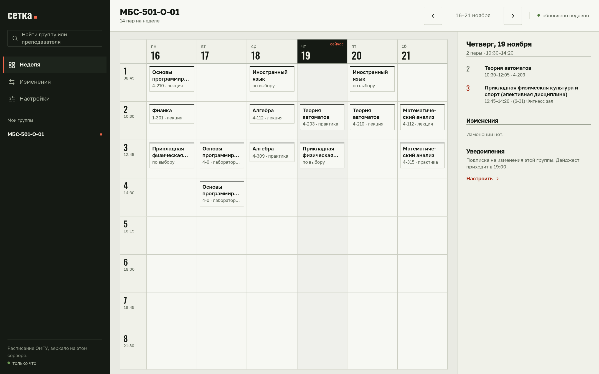
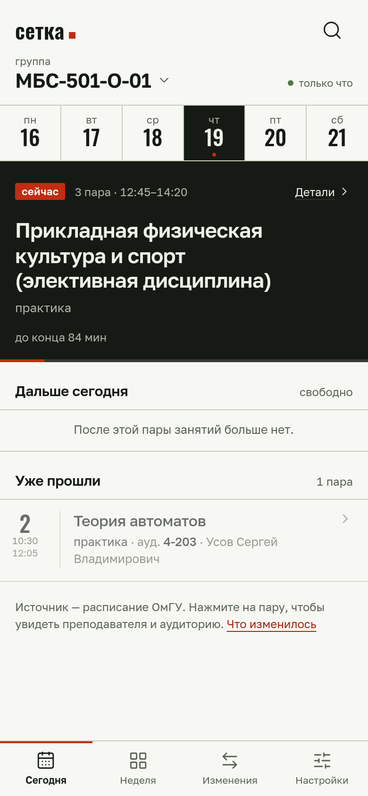
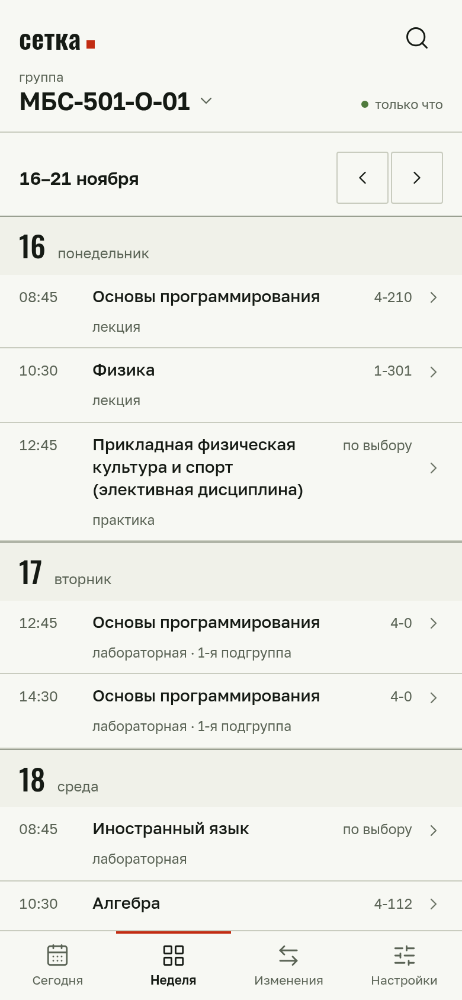
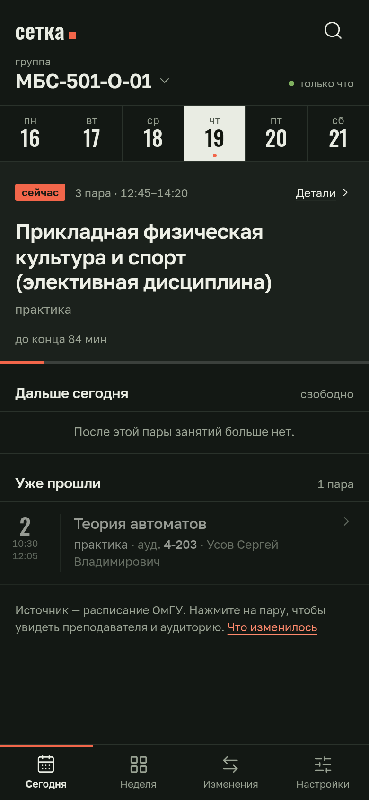

# сетка — расписание ОмГУ

Зеркало расписания ОмГУ им. Ф. М. Достоевского с мгновенной отдачей из кэша,
историей замен, push-уведомлениями и устанавливаемым PWA-интерфейсом.

**Публичный инстанс:** <https://s.pgeyko.ru>

[](docs/screenshots/week-desktop.png)

| Сегодня | Неделя | Тёмная тема |
|---|---|---|
|  |  |  |

## Зачем это нужно

Официальный сервер расписания периодически перегружен и медленно отвечает,
особенно с мобильного. «Сетка» скачивает расписание в фоне, хранит его в
SQLite и отдаёт из памяти за доли миллисекунды — даже если источник недоступен.
Интерфейс оптимизирован под сценарий «стою в коридоре, надо за пару секунд
понять, что сейчас и где».

## Возможности

- **Сегодня и неделя** — блок «сейчас» с прогрессом пары, следующие и уже
  прошедшие занятия; на десктопе — сетка недели с панелью дня.
- **Умный день** — после 18:00 или когда все пары закончились, экран сам
  показывает следующий учебный день (в воскресенье — понедельник); можно
  вернуться к сегодняшнему одним нажатием.
- **Замены** — история `added/removed/modified` с diff'ом по полям, лента
  «моя группа / все группы», пометки на парах.
- **Поиск** — группы, преподаватели и аудитории по части названия, номеру
  аудитории и корпусу (`4-112`, `112`, «корпус 4»), с недавними запросами и
  избранным.
- **Подгруппы** — фильтр расписания и уведомлений, запоминается локально.
- **Свободные аудитории** — карта занятости по корпусам, дням и парам с переходом
  на расписание комнаты.
- **Уведомления** — push об изменениях, вечерний дайджест на следующий день и
  напоминание перед парой (FCM; настраивается в приложении).
- **PWA и офлайн** — установка на телефон, кэш расписания, офлайн-баннер с
  временем последних данных, тёмная и светлая темы.
- **Короткие ссылки** — `/g/<id>` сам открывает `today` на телефоне и `week`
  на десктопе, а Telegram получает превью с названием группы и картинкой.
- **Экспорт** — iCal для группы, преподавателя и аудитории.
- **Интеграция с omsu_bot** — HMAC-подписанные вебхуки об изменениях.

## Как это устроено

```text
PWA (React) ──HTTPS──▶ nginx ──/api──▶ backend (Go)
                                                             │
                                         L1 sync.Map + JSON  │
                                         L2 SQLite (WAL)     │
                                         L3 upstream ────────┘
```

- Backend синхронизирует только «горячие» расписания (запрошенные за последние
  24 часа); остальные подгружаются лениво.
- Ответы кэшируются на трёх уровнях: память → SQLite → upstream.
- Справочники держатся в памяти, поиск нормализует ввод и не ходит в БД.

Подробнее: [docs/ARCHITECTURE.md](docs/ARCHITECTURE.md).

## Стек

| Слой | Технологии |
|---|---|
| Backend | Go 1.23, Fiber v2, SQLite (`modernc.org/sqlite`, WAL), zerolog, Swagger |
| Frontend | React 19, TypeScript, Vite 8, React Router 7, TanStack Query 5, Zustand 5, vanilla CSS, lucide-react |
| PWA | vite-plugin-pwa / Workbox, Firebase Messaging |
| Анимации | нативные View Transitions API + CSS (без animation-библиотек) |
| Инфраструктура | Docker, nginx, GitHub Actions |

## Быстрый старт

### Всё одной командой

```bash
git clone https://github.com/pgeyko/omsu_setka.git
cd omsu_setka
./run.sh          # тесты → сборка web → сборка backend → запуск на :8080
```

### Раздельно (hot-reload)

```bash
# backend
cd core
go run ./cmd/server/main.go

# frontend (в другом терминале)
cd web
npm ci --legacy-peer-deps
npm run dev       # http://127.0.0.1:5174, /api проксируется на :8080
```

### Docker

```bash
cp .env.example .env    # заполните ADMIN_KEY и CORS_ALLOWED_ORIGINS

docker compose up --build                                # только backend
docker compose -f docker-compose.local.yml up --build    # backend + frontend
```

## Тесты

```bash
cd core && go vet ./... && go test ./...   # backend
cd web  && npm test                        # 150 unit/component
cd web  && npm run build && npm run test:build
cd web  && npm run test:e2e                # 20 браузерных сценариев
```

CI дополнительно запускает `go test -race`, gitleaks и E2E с мок-API.

## Конфигурация

Все настройки — переменные окружения, шаблон с комментариями:
[`.env.example`](.env.example). В production обязательны `ADMIN_KEY` и
`CORS_ALLOWED_ORIGINS` без `*`.

Для реальных push-уведомлений нужны `VITE_FIREBASE_*` (build-args фронтенда) и
`FIREBASE_SERVICE_ACCOUNT` (backend). Без них интерфейс настроек работает, но
FCM-токен не выдаётся.

## Документация

- [docs/README.md](docs/README.md) — карта документации и быстрые факты.
- [docs/ARCHITECTURE.md](docs/ARCHITECTURE.md) — архитектура, кэш, БД, API,
  синхронизация, уведомления, вебхуки.
- [docs/core/DEVELOPMENT.md](docs/core/DEVELOPMENT.md) — backend.
- [docs/web/DEVELOPMENT.md](docs/web/DEVELOPMENT.md) — frontend.
- [docs/ADMIN_GUIDE.md](docs/ADMIN_GUIDE.md) — Admin CLI и мониторинг.
- [docs/UPSTREAM_API.md](docs/UPSTREAM_API.md) — API ОмГУ, который парсит backend.
- [docs/DESIGN.md](docs/DESIGN.md) — визуальная система.

## Структура репозитория

```text
core/          Go-сервис: API, кэш, SQLite, sync, уведомления, вебхуки
web/           React-PWA: экраны, стили, service worker, E2E
docs/          документация и скриншоты
.github/       CI (тесты и сборка)
admin.sh       Admin CLI (health, sync, incidents, logs, restart)
run.sh         локальные тесты и сборка
tools/         нагрузочный тест API
```

## Экосистема

Изменения расписания уходят в **omsu_bot (GroupBot)** по HTTP с
HMAC-SHA256-подписью (`X-Webhook-Signature`, `X-Webhook-Timestamp`,
`X-Webhook-Event-ID`). Бот регистрирует себя через
`/api/v1/admin/webhooks`. Контракт описан в
[docs/ARCHITECTURE.md](docs/ARCHITECTURE.md#вебхуки).
